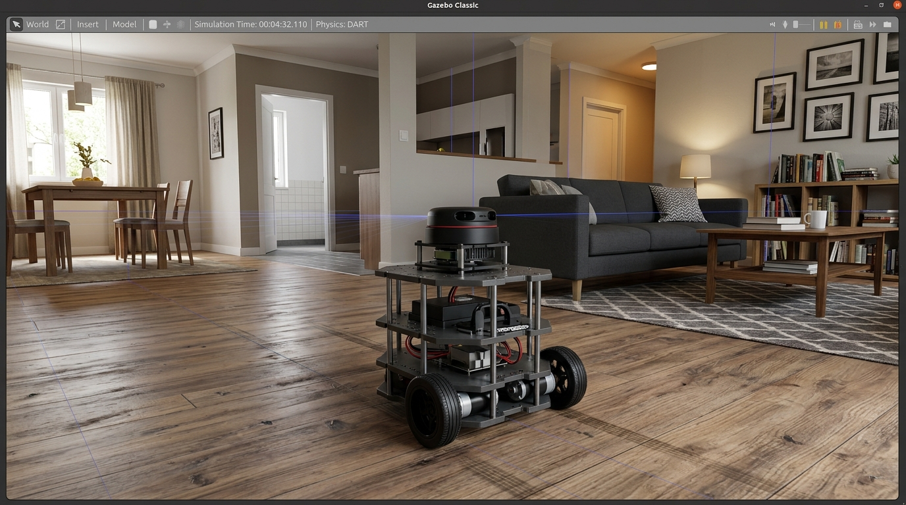
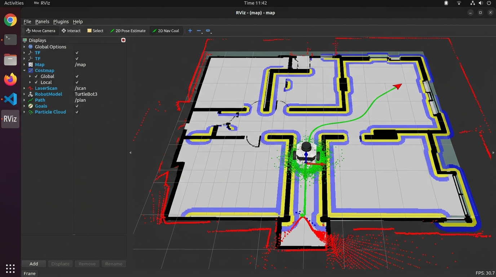
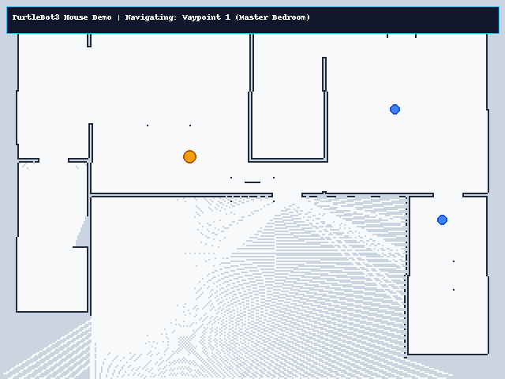

# TurtleBot3 Autonomous Navigation (ROS 2 Humble + Nav2)

[](https://docs.ros.org/en/humble/)
[](http://gazebosim.org/)
[](https://navigation.ros.org/)
[](https://emanual.robotis.com/docs/en/platform/turtlebot3/overview/)
[](LICENSE)

A TurtleBot3 Burger drives itself through the multi-room TurtleBot3 House world in Gazebo Classic 11, using the ROS 2 Humble Nav2 stack. A small Python script sends it to three goals in different rooms, and Nav2 plans the paths and steers around the walls and furniture on the way.

## Demo

**Screen recording (Gazebo + RViz + terminal):** [Watch on Google Drive](https://drive.google.com/file/d/1Pry_Y39XeSOTs2U075Rab5t69rVWeCvo/view?usp=drive_link)

<p align="center">
  
  
</p>

<p align="center">
  
  <br/>
  <em>Robot moving through the house floorplan across the three goals.</em>
</p>

---

## What it does

- Loads the TurtleBot3 House world and spawns a TurtleBot3 Burger (2D LiDAR + wheel odometry).
- Localizes on a pre-built map with AMCL, starting from a known pose of `(-2.0, 1.0, 0°)`.
- Plans global paths with `NavfnPlanner` (A* enabled) and follows them with the DWB local planner, which avoids obstacles using the local costmap.
- Runs a three-goal mission through `nav2_simple_commander.BasicNavigator` and prints distance-to-goal and time per goal.
- Opens RViz2 with a saved config (map, scan, costmaps, plans, particle cloud, TF).

**Scope note:** the obstacles here are the static ones in the house (walls, furniture, doorways). I did not add moving or unmapped obstacles, so replanning around something unexpected is not demonstrated in this repo.

## Tech stack

| Component | Choice |
|---|---|
| OS | Ubuntu 22.04 |
| ROS | ROS 2 Humble |
| Simulator | Gazebo Classic 11.10.2 |
| Navigation | Nav2 (Humble) |
| Localization | `nav2_amcl`, differential motion model |
| Global planner | `nav2_navfn_planner/NavfnPlanner` (A*) |
| Local planner | `dwb_core::DWBLocalPlanner` |
| Robot | TurtleBot3 Burger |
| Language | Python 3.10 |

## Repository structure

```text
TurtleBot3/
├── README.md
├── package.xml             # ROS 2 package manifest (ament_python)
├── setup.py / setup.cfg
├── requirements.txt
├── config/
│   ├── nav2_params.yaml    # Nav2 config (costmaps, AMCL, planners, controller)
│   └── rviz_config.rviz    # RViz2 layout
├── docs/
│   └── troubleshooting.md  # Problems I hit and their root causes
├── launch/
│   ├── bringup.launch.py   # Gazebo + Nav2 + RViz2
│   ├── navigation.launch.py# Nav2 + RViz2
│   └── simulation.launch.py# Gazebo + robot_state_publisher + spawn
├── maps/
│   ├── map.pgm             # Occupancy grid of the house (16 m x 12 m)
│   └── map.yaml            # 0.05 m/cell, origin [-8.0, -6.0]
├── scripts/
│   └── verify_setup.sh     # Pre-flight dependency check
├── src/
│   ├── navigation_demo.py  # Three-goal mission client
│   └── start_robot.py      # Launcher that starts Gazebo and Nav2 and cleans up after
└── worlds/
    └── turtlebot3_house.world
```

## Prerequisites

- Ubuntu 22.04 (x86_64), ROS 2 Humble Desktop at `/opt/ros/humble`, Gazebo Classic 11.

```bash
sudo apt update && sudo apt install -y \
  ros-humble-turtlebot3-gazebo \
  ros-humble-turtlebot3-navigation2 \
  ros-humble-nav2-bringup \
  ros-humble-nav2-simple-commander \
  ros-humble-gazebo-ros \
  ros-humble-robot-state-publisher \
  ros-humble-rviz2 \
  python3-transforms3d
```

The world, map, Nav2 params and RViz config are all in this repo, so nothing else needs downloading.

## Setup

```bash
cd <workspace_directory>
git clone <repository_url>
cd <repository_directory>

source /opt/ros/humble/setup.bash
export TURTLEBOT3_MODEL=burger
export GAZEBO_MODEL_DATABASE_URI=""   # stops Gazebo hanging on the dead online model DB

chmod +x scripts/verify_setup.sh src/start_robot.py src/navigation_demo.py launch/*.py
./scripts/verify_setup.sh
```

`start_robot.py` and `simulation.launch.py` set `GAZEBO_MODEL_DATABASE_URI` themselves, so the export is only needed if you launch Gazebo by hand.

## Run

You need two terminals.

**Terminal 1: simulation + Nav2**

```bash
cd <path_to_repository>
source /opt/ros/humble/setup.bash
export TURTLEBOT3_MODEL=burger
./src/start_robot.py --with-nav
```

This checks dependencies, clears leftover Gazebo/Nav2 processes and DDS shared-memory files, launches Gazebo with the house world, spawns the robot at `(-2.0, 1.0)`, and starts Nav2 and RViz2. Wait 10-15 s for:

```text
[READY] System is running. Press Ctrl+C to stop simulation safely.
```

> Don't start `start_robot.py` twice. Two simulations collide on Fast-DDS shared-memory ports and Nav2 never comes up.
>
> Heads up: the cleanup step runs `pkill -9` on `gzserver`, `gzclient` and `component_container`, so it will also kill any other Gazebo or Nav2 you have running. If you prefer, launch with `ros2 launch launch/bringup.launch.py` instead.

**Terminal 2: mission**

```bash
cd <path_to_repository>
source /opt/ros/humble/setup.bash
export TURTLEBOT3_MODEL=burger
python3 src/navigation_demo.py
```

It waits for `/clock` and the Nav2 action servers, sets the AMCL initial pose, then sends the three goals in order. The script exits when it's done. Press `Ctrl+C` in Terminal 1 to shut everything down.

## Goals

The room names below are just my own labels for places in the house.

| # | Label | X (m) | Y (m) | Yaw | Route |
|---|---|---|---|---|---|
| 1 | North-East room | 4.50 | 2.50 | 0° | Out of the living room through the doorway |
| 2 | South-East room | 6.00 | -1.00 | -90° | Through the connecting hallway |
| 3 | Start / living room | -2.00 | 1.00 | 180° | Back across the whole house |

Each goal has a 90-120 s timeout. The script reports whether Nav2 returned `SUCCEEDED`.

## RViz2 displays

The saved config (`config/rviz_config.rviz`) shows: robot model, TF tree (`map -> odom -> base_footprint -> base_link -> base_scan`), static map, laser scan, AMCL particle cloud, global and local costmaps, the global plan from the planner, and the local trajectory from DWB.

## Sample output

From one of my runs (times depend on your machine's simulation speed):

```text
[3/4] Executing autonomous navigation sequence (3 goals)...

--- Navigating to Waypoint 1 (North-East Master Room): x=4.50, y=2.50 ---
  [SUCCESS] Reached Waypoint 1 (North-East Master Room) in 39.1s!

--- Navigating to Waypoint 2 (South-East Sunroom): x=6.00, y=-1.00 ---
  [SUCCESS] Reached Waypoint 2 (South-East Sunroom) in 18.7s!

--- Navigating to Waypoint 3 (Return to Living Room Base): x=-2.00, y=1.00 ---
  [SUCCESS] Reached Waypoint 3 (Return to Living Room Base) in 48.1s!

 - Waypoint 1 : [PASS] (39.1s)
 - Waypoint 2 : [PASS] (18.7s)
 - Waypoint 3 : [PASS] (48.1s)
[DEMO COMPLETE] All navigation goals succeeded!
```

## Problems I ran into

Full write-ups are in [docs/troubleshooting.md](docs/troubleshooting.md). The main ones:

1. **Gazebo hangs or exits with code 255.** Gazebo Classic tries to reach `models.gazebosim.org`, which no longer serves models. Fix: `export GAZEBO_MODEL_DATABASE_URI=""`.
2. **Demo stuck on "Waiting for Nav2 stack lifecycle nodes to activate".** A leftover Gazebo/Nav2 process was holding Fast-DDS shared-memory ports. Fix:
   ```bash
   pkill -9 -f "gzserver|gzclient|component_container" || true
   rm -f /dev/shm/fastrtps_* /dev/shm/sem.fastrtps_*
   ```
   This is what `start_robot.py` automates.
3. **TF extrapolation errors.** Some node was using wall-clock time instead of Gazebo's. Fix: `use_sim_time:=true` everywhere, including `nav2_params.yaml`.

Useful checks when something looks off:

```bash
ros2 topic echo /clock --once
ros2 node list
ros2 lifecycle get /amcl
ros2 lifecycle get /bt_navigator
ros2 run tf2_ros tf2_echo odom base_link
```

## Limitations

- Simulation only. Real hardware would need motor drivers, LiDAR calibration and slip handling.
- Only static obstacles were tested. I haven't tried moving or newly placed obstacles, so dynamic replanning is untested.
- Needs a pre-built map. Unknown environments would need SLAM (`slam_toolbox` or Cartographer).
- Classical planning only (Navfn + DWB), with the default behavior tree and recovery behaviors.

## License

Apache 2.0. See [LICENSE](LICENSE).
