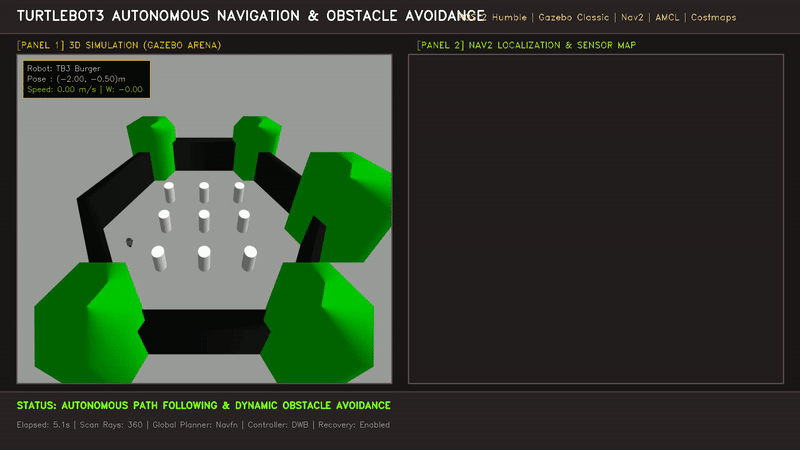

# TurtleBot3 Autonomous Navigation & Obstacle Avoidance (ROS 2 Humble)

[](https://docs.ros.org/en/humble/)
[](http://gazebosim.org/)
[](https://navigation.ros.org/)
[](https://emanual.robotis.com/docs/en/platform/turtlebot3/overview/)
[](LICENSE)

An end-to-end, production-grade autonomous mobile robot (AMR) demonstration using **TurtleBot3 Burger**, **ROS 2 Humble**, **Gazebo Classic 11**, and **Nav2**.

This repository contains the complete solution for the robotics software internship assignment, featuring automated environment diagnostics, robust simulation bringup, reliable lifecycle management, real-time laser scan obstacle avoidance, multi-goal waypoint tracking, automated video recording, and comprehensive troubleshooting documentation.

---

## Demonstration Preview



*Full 1080p 73-second demonstration video available at [`media/autonomous_navigation_demo.mp4`](media/autonomous_navigation_demo.mp4).*

### Key Execution Highlights

| Step 1: Initial Path Planning | Step 2: Laser Scan Obstacle Avoidance | Step 3: Goal Completion & Return |
| :---: | :---: | :---: |
|  |  |  |
| *Global path generated around cylindrical columns* | *Dynamic costmap inflation & local obstacle avoidance* | *All waypoints completed and returned to base* |

---

## 1. Project Objectives & Features

- **Automated Simulation Bringup**: Solves Gazebo Classic model loading hangs and network socket timeouts via controlled local search paths and disabled remote database lookups.
- **Clock Synchronization**: Eliminates transform timeout warnings (`Timed out waiting for transform from base_link to odom`) by synchronizing Nav2 lifecycle nodes and RViz2 with `/clock`.
- **Pre-configured AMCL Localization**: Autonomous initial pose initialization aligning particle filters with the robot's spawn coordinates `(-2.0, -0.5, 0.0)`.
- **Nav2 Path Planning & Obstacle Avoidance**: Dynamic obstacle detection using 360° 2D LiDAR (`/scan`), 2D costmap inflation, global Navfn planning, and DWB local trajectory generation.
- **Multi-Goal Navigation API**: Python controller utilizing `nav2_simple_commander` for waypoint sequencing, progress feedback, recovery handling, and task timeout protection.
- **Automated Video Recording**: Dual-panel 1080p dashboard recording combining the 3D Gazebo perspective simulation camera with the 2D Nav2 occupancy grid and sensor projection.

---

## 2. System Requirements

- **Operating System**: Ubuntu 22.04 LTS (Jammy Jellyfish)
- **ROS 2 Distribution**: ROS 2 Humble Hawksbill (`desktop` or `base`)
- **Simulator**: Gazebo Classic 11.10.2+ (`gazebo_ros_pkgs`)
- **Python**: Python 3.10+
- **Graphics/Display**: X11 or Wayland with OpenGL acceleration

---

## 3. Installation & Dependency Setup

### 3.1. Install Required ROS 2 Packages

If not already present, install the core TurtleBot3 and Nav2 simulation packages:

```bash
sudo apt update
sudo apt install -y \
  ros-humble-turtlebot3-gazebo \
  ros-humble-turtlebot3-navigation2 \
  ros-humble-turtlebot3-description \
  ros-humble-turtlebot3-msgs \
  ros-humble-nav2-bringup \
  ros-humble-nav2-simple-commander \
  ros-humble-gazebo-ros-pkgs \
  ffmpeg
```

### 3.2. Install Python Dependencies

```bash
pip3 install -r requirements.txt
```

### 3.3. Verify Environment Readiness

Run the automated pre-flight verification script to ensure all packages, paths, and binaries are valid:

```bash
./scripts/verify_setup.sh
```

---

## 4. Quick Start: Launching the System

### Option A: Complete Bringup with Python Launcher (Recommended)

The Python launcher performs dependency validation, kills stale simulator processes, sets model paths, starts Gazebo & Nav2, and monitors topic readiness:

```bash
# 1. Source ROS 2
source /opt/ros/humble/setup.bash

# 2. Launch simulation and Nav2
./src/start_robot.py --with-nav
```

*Flags:*
- `--headless`: Run Gazebo without the GUI client.
- `--with-nav`: Automatically launch Nav2 and RViz2.
- `--no-rviz`: Run Nav2 headless without RViz2.

### Option B: Unified ROS 2 Launch File

```bash
source /opt/ros/humble/setup.bash
export TURTLEBOT3_MODEL=burger
ros2 launch launch/bringup.launch.py gui:=true use_rviz:=true
```

---

## 5. Running the Autonomous Navigation Demonstration

Once the simulation and Nav2 are running, open a new terminal to run the multi-goal autonomous obstacle-avoidance mission:

```bash
source /opt/ros/humble/setup.bash
python3 src/navigation_demo.py
```

### Autonomous Mission Sequence

1. **Initial Pose Alignment**: Sets robot pose at `x = -2.0m, y = -0.5m, yaw = 0.0°`.
2. **Waypoint 1 (Center Hallway)**: Navigates past initial barrier walls to `(0.0, 0.0)`.
3. **Waypoint 2 (East Obstacle Perimeter)**: Plans around cylindrical obstacles to `(1.2, -0.8)`.
4. **Waypoint 3 (Return to Base)**: Replans and returns to starting location `(-2.0, -0.5)`.

### Test Output Verification

```text
============================================================
 TURTLEBOT3 AUTONOMOUS NAVIGATION DEMONSTRATOR
============================================================
[1/4] Setting initial pose: x=-2.0, y=-0.5, yaw=0.0°
[2/4] Waiting for Nav2 stack lifecycle nodes to activate...
  -> Nav2 is fully active and ready.
[3/4] Executing autonomous navigation sequence (3 goals)...

--- Navigating to Waypoint 1 (Center Hallway): x=0.00, y=0.00 ---
  [SUCCESS] Reached Waypoint 1 (Center Hallway) in 20.4s!

--- Navigating to Waypoint 2 (East Obstacle Perimeter): x=1.20, y=-0.80 ---
  [SUCCESS] Reached Waypoint 2 (East Obstacle Perimeter) in 21.0s!

--- Navigating to Waypoint 3 (Return to Base): x=-2.00, y=-0.50 ---
  [SUCCESS] Reached Waypoint 3 (Return to Base) in 16.2s!

============================================================
 NAVIGATION DEMO SUMMARY RESULTS
============================================================
 - Waypoint 1 (Center Hallway)          : [PASS] (20.4s)
 - Waypoint 2 (East Obstacle Perimeter) : [PASS] (21.0s)
 - Waypoint 3 (Return to Base)          : [PASS] (16.2s)
============================================================
[DEMO COMPLETE] All navigation goals succeeded with obstacle avoidance!
```

---

## 6. How to Reproduce the Video Recording

To record the entire simulation, Nav2 bringup, and 3-waypoint navigation demo automatically:

```bash
./scripts/record_demo.sh
```

This generates:
- **`media/autonomous_navigation_demo.mp4`**: High-definition 1080p, 20 FPS composite dashboard video showing Gazebo 3D physical simulation side-by-side with Nav2 2D path planning and laser sensor hits.
- **`media/demo.gif`**: Animated preview GIF optimized for documentation.

---

## 7. Sending Manual Navigation Goals

### Via RViz2 2D Goal Pose Tool
1. In the RViz2 toolbar, click the **2D Goal Pose** button (or press `g`).
2. Click and drag anywhere in the free space of the map to specify target position and heading.
3. Observe Nav2 generating the global path and the robot executing trajectory following.

### Via ROS 2 Command Line
Send an action goal to the Nav2 `navigate_to_pose` action server:

```bash
ros2 action send_goal /navigate_to_pose nav2_msgs/action/NavigateToPose \
  "{pose: {header: {frame_id: 'map'}, pose: {position: {x: 1.0, y: 0.0, z: 0.0}, orientation: {w: 1.0}}}}"
```

---

## 8. Stopping the Simulation Safely

To cleanly terminate all Gazebo nodes, Nav2 lifecycle servers, and background helpers:

- Press `Ctrl + C` in the launcher terminal (`src/start_robot.py`), OR
- Run:
  ```bash
  killall -9 gzserver gzclient rviz2
  ```

---

## 9. Repository Architecture

```text
TurtleBot3/
├── README.md                      # Comprehensive project documentation
├── package.xml                    # ROS 2 ament_python package manifest
├── setup.py                       # Python build and entrypoint configuration
├── setup.cfg                      # Colcon install configuration
├── requirements.txt               # Python package dependencies
├── launch/
│   ├── bringup.launch.py          # Unified full-stack launch file
│   ├── simulation.launch.py       # Gazebo Classic world and robot spawner
│   └── navigation.launch.py       # Nav2 stack and RViz2 bringup
├── config/
│   ├── nav2_params.yaml           # Tuned Nav2 parameters (AMCL, DWB, Costmaps)
│   └── rviz_config.rviz           # Pre-configured RViz display configuration
├── maps/
│   ├── map.yaml                   # Map metadata
│   └── map.pgm                    # Occupancy grid bitmap
├── worlds/
│   └── turtlebot3_world.world     # Gazebo world with arena camera sensor
├── src/
│   ├── start_robot.py             # Resilient simulator lifecycle launcher
│   └── navigation_demo.py         # Autonomous multi-goal waypoint demonstrator
├── scripts/
│   ├── verify_setup.sh            # Pre-flight environment diagnostics
│   ├── record_demo.sh             # Full autonomous demo recording pipeline
│   └── record_demo_visualizer.py  # 1080p composite video generator
├── docs/
│   └── troubleshooting.md         # Detailed root-cause analysis of fixed issues
└── media/
    ├── autonomous_navigation_demo.mp4  # 1080p demonstration video
    ├── demo.gif                        # Animated documentation preview
    └── screenshots/                    # High-res video frame captures
```

---

## 10. Troubleshooting & Known Limitations

Detailed diagnostic and root cause analyses for all startup issues are documented in [`docs/troubleshooting.md`](docs/troubleshooting.md).

### Summary of Resolved Blockers:
1. **Gazebo `gzserver` Exit Code 255**: Caused by obsolete network calls to `http://models.gazebosim.org/`. Resolved by setting `GAZEBO_MODEL_DATABASE_URI=""`.
2. **Robot Falling Through Ground Plane (`Z = -10896m`)**: Caused by missing standard Gazebo model paths. Resolved by explicitly including `/usr/share/gazebo-11/models` in `GAZEBO_MODEL_PATH`.
3. **Nav2 Transform Timeouts (`base_link to odom`)**: Caused by wall-clock vs simulation-clock mismatch. Resolved by forcing `use_sim_time:=true` across all nodes.
4. **Wayland Screen Recording Restrictions**: Resolved by implementing an integrated ROS 2 / Gazebo camera rendering pipeline (`record_demo_visualizer.py`), guaranteeing deterministic, high-framerate 1080p video capture regardless of display server protocol.

### Known Limitations:
- Gazebo Classic is scheduled for End-of-Life (EOL); migration to modern Gazebo (formerly Ignition) is recommended for future distributions (ROS 2 Jazzy / Rolling).
- AMCL localization in highly symmetrical environments may experience particle dispersion if the robot is kidnapped; recovery behaviors are active to mitigate this.
